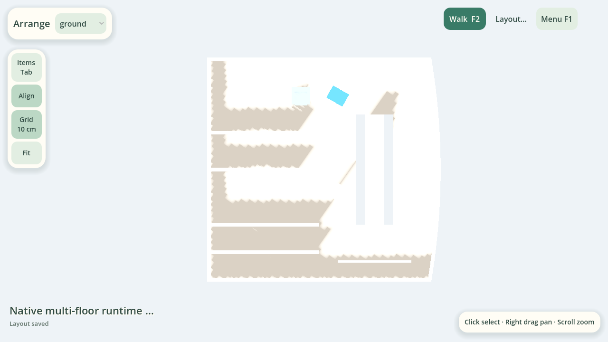
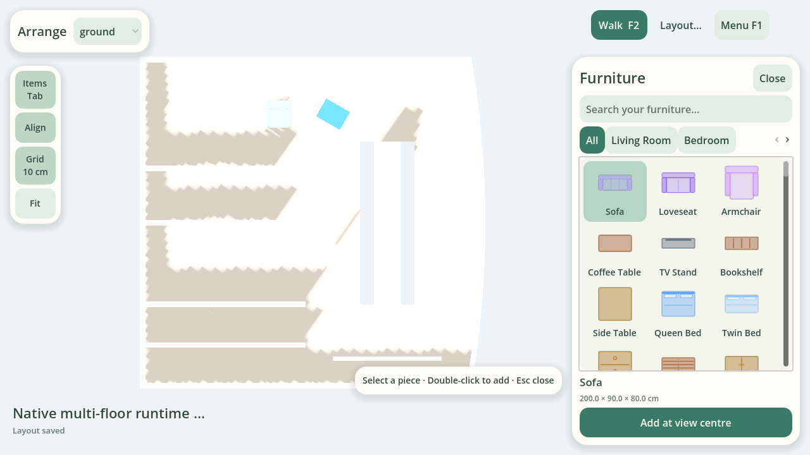

# Native Godot furniture layout

The desktop product uses one Godot 3D world for first-person exploration and
furniture layout from above. The browser remains an internal reconstruction,
architecture-editing and review tool; it is not required in a delivered player.
The native Plan2World `Project` remains the saved source of truth.

Settled plan view uses **orthographic projection**: camera size determines
world span, while altitude only clears authored wall tops. Drawer/resize framing,
zoom, parallel picking and snapping retain that projection. First person uses its
own perspective camera; transitions match floor-plane framing at the boundary.
The [user guide](user-guide.zh-CN.md) covers both Skill and native desktop creation.
Optional OpenRouter image creation delegates to a separate authoring process;
the furniture edit core and runtime scene loading remain offline.

## Controls and scope

| First person | Top view |
| --- | --- |
| WASD / left stick move; right stick or mouse looks | Visible pointer selects and drags furniture |
| E / gamepad A interacts with doors | First-person movement/look/door actions are disabled |
| F / gamepad X focuses furniture within 2.5m | Middle/right drag pans; wheel zooms |
| Arrows tap 1cm; hold / left stick adjusts up to 8cm/s | Ground items stay on their floor; mounted items follow their wall |
| F / Enter / A places; Esc / B cancels the preview | Esc cancels a furniture preview |
| F2 / gamepad Y switches view | Same camera transition returns to the existing player pose |

During first-person furniture adjustment, locomotion and door actions stop.
Mouse/right-stick input controls look only; it never drags furniture. Floor
movement follows the view heading in native X/Y (Godot X/Z), with fixed height.
Mounted-item left/right follows the authored wall; up/down changes installation
height within that wall. A cancelled preview was never an accepted edit.

F1 opens the scene menu. Focus loss pauses, clears held movement and cancels
previews in either mode; explicit resume returns to that mode. A release over
a toolbar ends the gesture. The top-view floor selector hides other authored
floors and ceilings for inspection, without removing their physics or changing
source geometry. Fit view reserves the compact tool rail and any open catalog drawer. Opening/closing the drawer and resizing preserve the chosen plan centre and relative zoom; Fit explicitly restores the floor frame. Native UI text remains at readable pixel sizes.

Furniture-only editing supports add, move, clockwise 90-degree rotation,
replacement, removal, **Layout… → Save layout…** (native JSON with retained model
attachments) and **Layout… → Export scene…** (the existing runtime ZIP). Architecture, door
semantics, floors, holes and stairs are fixed. The catalog offers existing built-in
furniture and custom models already retained in the Project; importing new model
files and arbitrary rotation controls are outside this milestone. Native locks
remain enforced. Compiled scenes opened without their source Project allow
read-only top view; choose **Arrange a Project…** to edit native JSON or a
Project package ZIP. Unsaved changes require an explicit discard before opening
another source/scene or closing the app.

There is no product Undo/Redo, operation log or retained edit history. Only the
current native Project is saved, including furniture positions, rotation, asset
identity and explicit wall binding. Browser internal authoring keeps its own undo.
Wall-mounted catalog items require a chosen straight solid wall, side and bottom
height. Curved-wall attachment is explicitly unsupported; existing unbound wall
items stay visible/selectable but cannot be moved until explicitly attached.

## Arrangement workflow

The default view gives the room most of the screen. The left rail contains Items,
alignment, grid and Fit; mode/floor controls sit at the top, the project/saved
state at bottom left, and contextual input hints at bottom right. A permanent
inspector and full-width command bars are no longer part of this flow.

- **Tab / Items** opens or closes the right-side furniture catalog. It works even
  when the grid/search owns keyboard focus; **Ctrl+F** focuses search, and
  **Esc / gamepad B** closes the catalog.
- Category tabs and search filter a visual grid. Symbols reuse the existing
  native furniture drawing helpers; dimensions come from catalog/custom-model
  definitions. Illustrations are not GLB model renders. Category, search and
  choice persist across closing/reopening. Selecting a tile changes no Project.
- **Add at view centre** uses the existing validated add command. Pan the room to
  choose that location; an accepted add closes the catalog and reveals the piece
  actions. A blocked add leaves the catalog open with its explanation. This
  milestone does not add a new-item cursor ghost or a finite inventory system.
- Selecting a placed piece reveals **Rotate / R**, **Swap / X** and **Remove / Del**.
  Swap opens the same catalog in replacement mode and commits only after the
  separate confirmation, preserving native identity and item count. Selecting
  another floor clears the old replacement target and returns to Add mode.
- Wall furniture opens a focused installation dialog for an explicit wall, side
  and bottom height. Cancelling it returns to the catalog without an edit.
- **Layout…** contains native Save/Export dialogs; **Ctrl+S** opens Save. Opening
  inventory cancels an uncommitted drag. Hints, snap feedback and errors do not
  consume pointer events or become hidden clickable overlays.

This organization takes cues from game furnishing workflows, including
[Nintendo's Happy Home Paradise overview](https://play.nintendo.com/media/videos/animal-crossing-happy-home-designer-trailer/).
All controls, focus, transitions and spatial interaction remain native Godot.
No reference-game art is packaged.

## Magnetic placement and native UI

Top-view **dragging** starts with magnetic alignment and a 10cm grid enabled.
Both switches stay on the compact left tool rail.
**Align** controls all assistance; **Grid 10cm** independently disables
the grid while retaining wall/furniture alignment. Hold **Alt** during a drag to
release all snapping, including automatic orientation, at the current pointer.
Releasing Alt reacquires an eligible target. Nothing changes imported positions
until the user accepts a gesture. Add places a piece at the view centre; dragging
then uses these same placement aids.

| Assistance | Behavior |
| --- | --- |
| Grid | Native world X/Y in 10cm intervals; fixed floor elevation |
| Straight solid wall | Back edge flush with authored thickness and mirror-aware orientation; front faces away; grid applies along the wall without changing clearance |
| Furniture guides | Nearby same-floor footprint edges/centres, projected onto native X/Y; guides show the selected alignment |
| Capture/release | 6cm capture, 12cm release hysteresis; stable entity-ID tie order |
| Explicit mounted item | Along-host grid only; keeps host, side, height and orientation |
| First person | No magnetic/grid snapping; keyboard taps remain 1cm and gamepad adjustment remains gradual |

Wall assistance excludes curves, air/railing boundaries, other floors, short
hosts and apertures overlapping the item's height. A low item can fit below a
window sill. Magnetic candidates still pass the existing floor-support, live
physics and closed-door checks. A blocked candidate releases to the constrained
pointer pose; if that pose is invalid, red feedback and drop rejection remain.
Neither GLB bounds nor presentation meshes provide snap targets or collision.

`furniture_snapping.gd` is native input assistance over compiled semantic walls
and effective item dimensions. It does not construct architectural geometry or
create attachment metadata. An aligned ground item remains a floor item;
wall-mounted pieces still require the chosen native `wallMount`. The internal
browser has separate authoring grid/wall/guide tools; automatic cross-engine
wall attachment is not implied.

A wall-aligned position and rotation reach the shared native editor as **one
move command** with optional `rotation`. The core validates orientation, retains
stable IDs and compiles a single accepted pose for presentation and collision.
Mounted-item commands cannot use this optional rotation. Cancel restores both
position and orientation without history.

All menus and overlays use native Godot Controls and the shared warm paper/sage
theme. Furniture browsing, selection actions, transient placement feedback and
file operations have separate places in the layout rather than sharing one
always-visible inspector. First-person HUD and constrained input remain intact.





## Ownership

`furniture_catalog_view.gd` owns category/search/selection over a read-only UI
projection from the offline core. Its symbols are standard SVG 1.1 inventory
illustrations; they never enter runtime JSON, asset fitting or collision. Native
`runtime_plan_view.gd` binds UI actions to existing commands. The composition
root closes the catalog only after an accepted add/replacement.

`layout_camera.gd` owns a native Camera3D transition, ray picking, pan/zoom, drag
preview and Godot shape queries. The transition interpolates within the same
world; it does not teleport the player or recreate doors. Player processing is
suspended during layout/transitions. Physics stays active for spatial queries
unless the scene menu or focus loss pauses it. Furniture edits replace only the
furniture subtree, preserving architecture, player and door state.

Selection Areas use emitted furniture effective sizes on a separate physics
layer. They are editor targets, not walking collision. Preview moves the actual
loaded model; physics is committed only after the edit succeeds. Placement
queries use the compiler's box collider against the current Godot world, excluding
the selected item's old collider and room floor surfaces. Wall/door/furniture/
player overlaps are rejected without committing a state. Non-colliding native
markers remain selectable and do not acquire mesh-derived physics. No additional
room containment/topology inference is performed. Ground support uses the
compiler-owned floor collision, including holes; the adapter does not infer
rooms. Wall frames and blocked door/window rectangles come from the compiler.
Door animation checks native physics before advancing its explicit leaf pose;
an obstruction stops motion without penetrating furniture or the player.

The shared artifact compiler also reserves each explicit door leaf's **closed**
collider volume against furniture effective boxes. The check uses authored yaw
and world height, includes flat/non-walking items, and allows touching faces.
Leafless passages have no reserved leaf. It does not infer or reserve a complete
swing envelope. A nearby chair may still stop live swing motion, but the saved
layout is clear when doors reopen in their default closed pose.

Godot previews reuse these emitted boxes as editor-only `Area3D` nodes on layer 4.
They are queried for placement together with world bodies, never for locomotion,
door animation, floor support or furniture picking. Static reservations survive
furniture-only updates; they do not follow the animated leaf. Shared compilation
remains the final authority for accepting an edit or exporting a scene. Invalid
externally saved Projects fail to open without destroying the active world;
internal native authoring and JSON backup remain available for correction.
Older compiled snapshots should be re-exported to execute the current rule.

`layout_session.gd` delegates native data edits to a separate, offline shared core:

```text
Godot native UI/gesture
  → engine-neutral furniture command (native centimetres/degrees)
  → applyFurnitureLayoutCommand(native Project clone)
  → existing compileRuntimeArtifacts + runtime package serializer
  → isolated candidate
  → Godot validates placement against native physics
  → replace current Project and consume compiled furniture artifacts
```

`core/layout-core.cjs` bundles existing pure TypeScript model/validation/package/
compiler code. `core/node` or `core/node.exe` is a pinned, checksum-verified Node
24.19.0 x64 runtime bundled with the player; `core/models` reuses the existing GLBs
and attribution. No browser, HTML, WebView, AI or server is used. Node handles data
and compilation, never Godot UI, animation, ray picking or collision decisions.
Candidates are staged in `user://layout-sessions`; the original input is never
automatically overwritten. Acceptance deletes the previous private state;
rejection deletes the candidate. Closing releases the private directory while
keeping explicitly saved Projects. Save/export writes a temporary sibling and
renames it into place; failure retains dirty state and the existing destination.
There is no persistent editor-session recovery.

## Entrance and loading lifecycle

The internal authoring entrance picker stores one explicit Project main door and
its inward side: `floor.entrance = {doorId, side: "left" | "right"}`. The compiler
emits an interior offset and inward-facing yaw. Export rejects missing floor
clearance or a blocked anchor instead of moving it to a convenient location.
Furniture edits must preserve this entrance clearance. Old Projects without a
marked door retain their legacy explicit/automatic start, which export also
validates. There is no largest-door heuristic in Godot.

Loading validates the consumer contract and the optional compiler GLB SHA-256,
then constructs resources, presentation and collision outside the active tree.
Only a complete candidate replaces the world and editable source; a failed load
retains both. Missing assets use explicit compatibility proxies. A present GLB
with a mismatched digest is rejected. Re-export old derived snapshots when their
required furniture/door contract predates this version.

Native Project compilation runs in the offline worker; GLB import/node staging
remains synchronous. Large-scene loading progress/background resource preparation
is a future performance task. Transactional replacement does not promise
nonblocking imports.

`runtime_artifacts.gd` and `runtime_loader.gd` continue to consume compiled
artifacts only. Neither imports native Project data, constructs topology, computes
asset bounds, triangulates rooms or creates presentation geometry. The importer
registers Godot's official `GLTFDocumentExtensionConvertImporterMesh`, ensuring
runtime GLBs instantiate renderable MeshInstance3D nodes with ownership extras.
`.tscn` remains adapter composition, never a canonical scene representation.

## Develop and verify

Build the offline core once, then point the development Godot process at it:

```bash
node tooling/build-layout-core.mjs /tmp/p2w-core
export P2W_AUTHORING_CORE=/tmp/p2w-core
Godot_v4.7.2-stable_linux.x86_64 --path runtime/godot
```

Normal player builds include this core automatically; no environment setting or
user Node installation is needed. Build-time Node downloads are pinned and
verified; runtime operations use only local files.

The real-engine gates are `runtime_launcher_test.gd` (camera interpolation,
mode-specific input, floor switch, pan/zoom, focus/menu recovery and preserved
player/door/world state) and `runtime_layout_test.gd` (native Project entry,
asset-backed CRUD, ray drag, native units, collision rejection, save,
export and reopen). `runtime_assets_test.gd` also requires renderable imported
meshes and preserved ownership. The relocated delivery test runs these against
the exported PCK and shipped core from UTF-8 paths containing spaces, then boots
the actual release executable. With a real display, the layout gate additionally
captures native top view, drag preview, camera transition and first person.
`runtime_snapping_test.gd` verifies deterministic semantic capture/release, wall sides/diagonals, aperture/height exclusions, stable target order and explicit host retention. `runtime_snapping_controls_test.gd` exercises actual pointer/Alt/toggle input, atomic pose save/reopen, physics rejection, spatial feedback and compact native UI framing against the shipped PCK.

`runtime_layout_ui_test.gd` checks native category/search/tile input, modal
wall installation/cancellation, add/swap confirmation, identity/count retention,
contextual shortcuts, Tab/focus/gamepad-B closure, 800×540 catalog bounds, preserved
plan centre/zoom and unchanged source/architecture. It runs through the relocated
PCK/core delivery gate.

`runtime_product_controls_test.gd` adds entrance/facing, malformed JSON and wrong
GLB recovery, unsupported floor/hole placement, interrupted drag, actual keyboard
and virtual-gamepad input, wall-bound movement, obstruction and save-failure tests.
It runs against the shipped PCK/core in both platform delivery jobs.

## Local verification record

Merged foundation: PR #80 (`1c4ec13` on main). Layout follow-up branch:
`godot-layout-flow`, kept local until publication is requested. Keep the scope at native house
walkthrough and furniture arrangement; these controls do not introduce a general
scene editor, scripting system or alternative canonical data model.

| Milestone | Evidence and conclusion |
| --- | --- |
| `ab865c3`: native cameras/layout | [Original results](../.plan2world-validation/runs/20261025-godot-plan-view/RESULTS.md). 1,665 unit tests, native mode separation/CRUD, packaged Linux and rendered inspection passed. The flat canvas prototype was removed. |
| `2582099`: entrance, loading and controls | [Product-control results](../.plan2world-validation/runs/20261025-product-controls/RESULTS.md). 1,670 unit tests; entrance/facing, transactions, no history and constrained controls passed. Frozen real-house replay retained all architecture/input bytes. Closed-pose doorway placement remained explicitly unresolved. |
| `30964ba`: door/layout lifecycle | [Door/layout results](../.plan2world-validation/runs/20261025-door-layout-lifecycle/RESULTS.md). 1,684 unit tests passed. Shared export/CLI checks and native pointer/micro-adjustment reserve default closed poses; save/export/reopen and real walking are covered by the shipped-PCK gate. |
| `a09a0d8`: cleanup/readiness | [Review results](../.plan2world-validation/runs/20261025-stability-review/RESULTS.md). 1,684 units, type/build/catalog checks, high-threshold audit, rebuilt Linux/Windows packages and Linux shipped-PCK delivery/asset gates passed. Snapping status is documented; no snapping behavior was added. |
| PR #80: snapping/UI | 1,685 units, 42 focused cross-browser cases and shipped Linux PCK/core gates pass. Native magnetic/grid controls, atomic pose, compact UI and live missing-model notices; see [validation record](../.plan2world-validation/runs/20261025-snapping-ui/RESULTS.md). |
| Local arrangement flow | 1,686 unit tests; packaged Linux UI/input/data gates and rendered inspection pass. On-demand catalog, contextual actions, secondary file commands and preserved view framing; see [local results](../.plan2world-validation/runs/20261025-layout-flow/RESULTS.md). |
| Local orthographic / desktop creation | 1,700 unit tests, six focused Chromium regressions, packaged Linux controls and rendered inspection pass. Native OpenRouter account/image flow uses a mocked provider; real account/model and Windows hardware acceptance remain separate. See [verification record](../.plan2world-validation/runs/20261026-ortho-desktop/RESULTS.md). |

## Publication and acceptance

PR #80 merged the native cameras, furniture editor, snapping, entrance/loading
and door-clearance foundation. The follow-up changes the furnishing UI layout
and catalog projection; local evidence lives in
[layout-flow validation](../.plan2world-validation/runs/20261025-layout-flow/RESULTS.md).
No new GitHub push or formal release is implied by this local follow-up. Linux/Windows native Godot
jobs are both required by the aggregate CI gate. PR browser/benchmark skips
remain as before; full browser/benchmark jobs run on main push.

The merged foundation evidence is
[snapping/UI validation](../.plan2world-validation/runs/20261025-snapping-ui/RESULTS.md).
Linux packaged acceptance and rendered Compatibility inspection do not establish
native Windows Forward+ hardware or physical-controller quality. Retain those
platform/manual checks before a general desktop release. No new reconstruction
observations, geometry correction, lighting or source-image results are part of
this UI/editing change.

Door/layout milestone `30964ba` additionally fixed notice ownership: camera/toolbar refresh must
retain an operation's explanation until the next edit. A hidden top-view toolbar
must not reframe the world or cancel first-person adjustment. Its first negative
run caught the overwritten explanation. A second test waited for a camera tween
while the failed-open menu intentionally paused it; that test now waits for data,
asserts the paused retained world, explicitly resumes, then checks the animation
settles within the unchanged deadline. Negative logs remain in the run directory.
Historical implementation diaries stay in Git history; evidence and negative
results linked above remain available. No extraction prompt, source observation,
geometry correction, material or lighting change is part of this round.

### Remaining acceptance and limits

- GLB staging is synchronous; each accepted edit still recompiles a complete
  package in a new offline process and rebuilds furniture. Measure large-scene
  latency before choosing optimizations; subprocess cancellation/timeouts and
  crash recovery remain separate work.
- Closed-pose clearance does not promise that a door can complete its full live
  motion. Native physics may stop it on a player or nearby furniture. Old
  compiled snapshots require re-export; the engine does not rerun authoring
  validation or repair their source data.
- Floor support samples the center/corners of furniture against emitted floor
  collision; it does not certify continuous support under every footprint point.
- Wall attachment supports straight solid walls only. Legacy unbound items need
  explicit attachment; new model-file import is outside this scope.
- Wall selection uses an explicit wall list; in-world wall picking and material/lighting
  polish remain future work. Initial load and furniture edits refresh the native
  missing-asset notice. Target-device usability still needs manual acceptance.
- Linux headless/Mesa inspection and Windows cross-builds do not establish native
  Windows Forward+, physical controller, file-dialog or OS resize/DPI acceptance.
  Main-push full browser/benchmark coverage and the current publication/checks
  belong in the evidence record rather than inferred from older runs. Complex
  stairs/special doors and optional low-yield observation experiments stay deferred.
