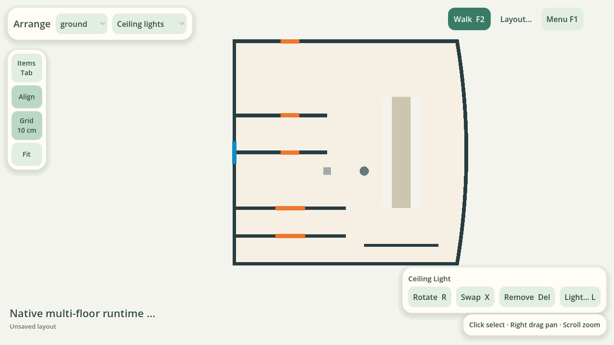
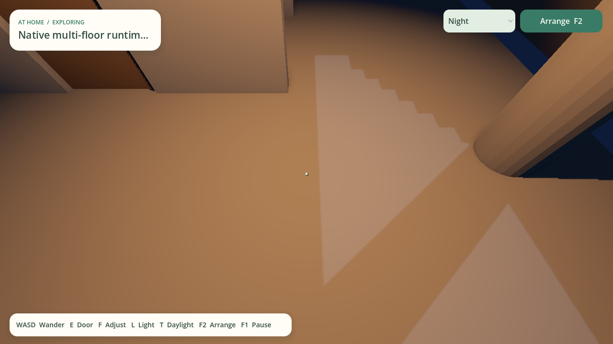
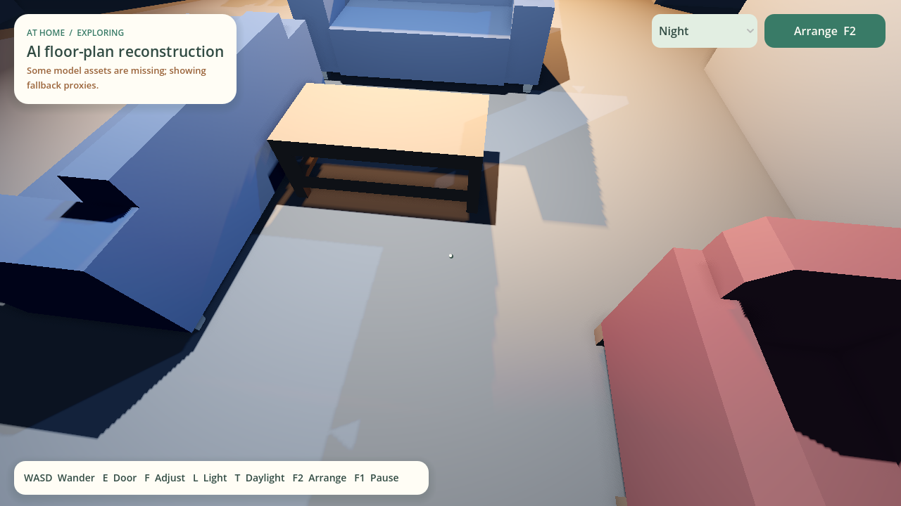

# YJ215 原图到 Godot 验证（2026-10-26）

**结论：编辑、照明与保存链路通过；整套户型漫游仍有明确缺口。** 三处阳台
多轨推拉门不能用当前单整叶模型正常打开，不能把这次结果写成“所有空间均可通行”。

原图 SHA-256：`de827282bce49c497eb5568efcd1283932346f1025ca770afa982f6adbc26013`，
1280×855。入口是 Codex 直接执行当前仓库 Skill，未使用旧候选作为输入，未调用
OpenRouter 或其他付费 API。这不证明桌面外部模型的识图质量。

## 两轮执行与责任层

第一轮冻结建筑与家具观察后，完成程序重建、原图叠加检查、原生导入、浏览器审查
和运行时导出。实测发现大门左端点观察错误：取了黑墙角，门叶与相邻墙重叠。
另外，正对双扇门细缝的单条交互射线可能漏选。前者属于源观察，后者属于引擎输入。

第二轮从原图重新执行完整流程，将大门端点观察在白色门框内缘；没有修改第一轮
JSON、原图或生成模型。北侧卫生间入口和主卧隐私分隔继续保留不确定性，没有为了
连通性补猜门墙。引擎交互改为 1.5cm 半径的原生形状探测，保持墙遮挡、玩家排除
和距离限制，不扩大物理门叶，也不忽略墙碰撞。

程序输出 49 面墙、11 个门/通道、10 扇窗、12 个原生区域、55 个家具语义点。
几何检查 0 error / 0 warning，统一尺度注册通过。13 个源功能区中 11 个独立闭合；
北侧卫生间缺可靠入口，主卧与公区的隐私边界未解决。这些是源审查结果，不被
“几何无报错”覆盖。飘窗/种植台的竖向台面未建模；主入口不等宽门叶仍使用原生
双叶等分默认，未声称精确还原叶宽。

## 冻结后的人为布置测试

这是另外保存的用户布置版本，不作为 AI 抽取效果改善：

- 13 个既有语义物体替换成沙发、茶几、扶手椅、餐桌椅、床、衣柜资产，并明确旋转。
- 新增墙画和镜子，显式保存墙、墙侧、安装高度；新增四种吸顶灯，明确选择原生顶面。
- 实际指针拖动、吸附、穿墙拒绝、第一人称墙面/顶面微调、露天阳台拒绝装吸顶灯。
- 第一人称由大门出生，检查关门碰撞、双扇联动开关，沿六个路点实际行走到公区，
  不瞬移角色；相机切换、家具编辑保留同一世界和开门状态。
- 原生保存/重开、灯具设置保留、Godot 导出与 CLI ZIP 一致，重复导出字节稳定。
  建筑原生字段及 architecture GLB 字节保持不变，所有静态 owner 均可解析。

布置版共 61 件家具、131 个运行实体、139 个碰撞体，12 个资产描述符、27 个实际
资产实例（含门叶）。剩余 42 个源语义物体及墙画/镜子没有实际 GLB，仍明确显示
44 个 fallback，不把 sourceCategory 猜成模型，也不声称已补齐资产库。

实际 Compatibility / Mesa 窗口的客厅地面采样：

| 夜晚灯光 | 地面 RGB |
| --- | --- |
| 800lm / 2700K | 0.6814, 0.4941, 0.3255 |
| 关灯 | 0.0431, 0.0745, 0.1294 |
| 800lm / 6500K | 0.6814, 0.6971, 0.7127 |

白天、夜晚、日出、日落均实际切换并保留原始截图。白天预设有明显局部过曝，
尚未做亮度/材质校准；本轮没有为了截图修改生成几何或单独美化该案例。

## 阳台门追加检查：未通过

玩家远离门体时，分别检查原生滑门的完整移动，排除玩家阻挡：

| 门 | 当前整叶目标行程 | 实际移动后被墙阻挡 | 完全打开 |
| --- | --- | --- | --- |
| 北侧服务阳台 | 3.356m | 0.045m | 否 |
| 主卧阳台 | 3.556m | 0.189m | 否 |
| 客厅阳台 | 6.956m | 0.210m | 否 |

当前 `sliding` 原生数据只建立单叶平移，未保留这类多轨门的叶数、轨道、固定扇
及每叶行程，不能唯一恢复真实开启几何。Godot 正确保留侧墙碰撞；没有用穿墙、
缩门、改成平开或删除边界来伪造可通行。**下一优先级应是增强原生推拉门配置和
共享编译契约，再实现对应的显式每叶运动。** 场景不应被当作所有阳台均可通行的成品。

## 验证质量与证据

本轮修正了三个旧引擎测试中的错误 GLB 路径：必须解析实际文件，验证 64 位哈希
并匹配编译器 digest，避免把两个空字符串当作“建筑字节相同”。新增原生门缝、
自身排除、墙遮挡和距离回归，接入搬移后 PCK 的第十组验收。完整单元、类型、
构建及 Linux/Windows Godot CI 记录在 PR #81；PR 的 browser/benchmark 按既有政策跳过。
本轮 audit 为 0 high/critical、3 low（SvelteKit 和两个 adapter 的关联告警）。修复建议
涉及跨大版本升级，留作独立维护；没有把 required audit gate 通过写成零告警。

完整证据在本地忽略目录
`.plan2world-validation/runs/20261025-yj215-desktop-e2e-1807/`：两轮原始观察、冻结哈希、
程序审查、浏览器下载的 Project、原生布置结果、原始截图、失败日志、门运动审计及
`RESULTS.md` 均保留。原图和带原图背景的 Project 不作为公共 fixtures 上传。
本机显示验收使用软件 Compatibility；原生显卡、DPI、系统文件框和物理手柄仍需
目标机器验收。单张单层户型不建立复杂楼梯或多层识图能力。
