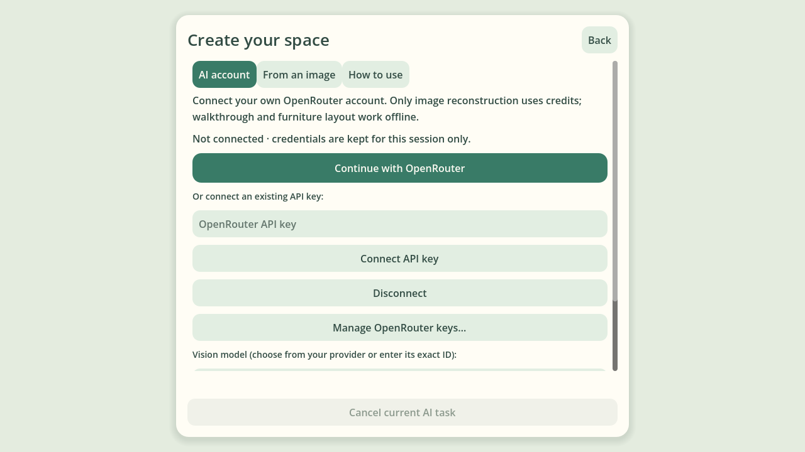

# Plan2World Godot runtime

This directory is a deliberately small consumer of `plan2world-runtime-v1` plus its sibling `architecture.glb` presentation artifact.
It is **not** a second authoring model and must never become the source of truth for a house.
The editable Plan2World `Project` remains authoritative. Runtime loaders consume compiled artifacts; a separate native furniture editor delegates Project edits/compilation to the packaged shared core. All UI, cameras, picking, drag and collision checks run in Godot.

[中文使用说明书：插件 / Skill 与独立桌面](../../docs/user-guide.zh-CN.md).
Optional **Create from a floor plan…** and **AI account…** use a separate native
authoring surface and shared reconstruction process. OpenRouter login/API keys
stay in session memory; explicit consent precedes paid observations. Existing
Project editing and runtime scenes remain offline and require no account.
Settled top view uses orthographic projection; first person stays perspective.



## Target

- Godot 4.7.2 stable (Standard build is sufficient)
- Desktop Forward+ renderer
- Windows is the first manual test target

Core CI defines native Linux and Windows jobs with verified official Godot 4.7.2
builds. They parse/import the project, boot the explicit demo, check native-export
assets and a grounded walkthrough, then verify desktop delivery. A runtime/GDScript
change is not considered merge-ready if these gates fail. Native Windows headless
checks and Windows Forward+ hardware acceptance are distinct.

## Run the standalone player

Extract the Windows/Linux player ZIP, start its executable and choose **Explore
a scene…**. Extract the editor's **Export runtime scene (.zip)** output
and select `scene.runtime.json`. Keep its sibling GLB/assets directory together.
F1 opens a paused scene menu with resume, **Return to start** and scene switching;
failed opens retain the current walkthrough. Desktop focus loss pauses and clears
held controls; focus return waits for explicit resume. Return to start resets only
the player to the compiled spawn, retaining door states and all scene geometry.
F2 smoothly switches to top view in the same 3D world. Top view uses visible-pointer furniture selection, middle/right pan and wheel zoom, with first-person controls disabled. **Arrange a Project…** enables furniture add/move/rotate/replace/remove, native save and runtime export, with no undo/history; architecture stays fixed. No browser, Godot editor or Node installation is required for delivered players. See [native layout scope, ownership and development](../../docs/godot-furniture-layout.md).
See [offline delivery and build instructions](../../docs/runtime-delivery.md).

F / gamepad X focuses nearby furniture in an editable Project. Arrow taps move
1cm; held arrows or the left stick move gradually. F / Enter / A places; Esc / B
cancels the preview. Movement stops while adjusting; mouse/right stick only
looks. Floor furniture stays in its plan plane. Mounted objects use the explicit
wall/side/height chosen in top view, and move only along that wall or vertically.
Curved-wall mounting is currently unsupported. In top view, Tab opens the category/search furniture grid; Esc / gamepad B closes it, Ctrl+F searches. Selected pieces expose Rotate/R, Swap/X and Remove/Delete; Layout… holds Save/Export, with Ctrl+S for Save. Wall installation uses a separate explicit-host dialog. Top-view dragging supports a 10cm grid, straight-wall flush/orientation and furniture alignment guides; use the visible switches or hold Alt for free placement. Magnetic assistance never affects first-person micro-adjustment.

Furniture placement reserves the explicit closed-door volumes even while doors
are open. The shared compiler checks the same poses before accepting/exporting
layout data. Near-door furniture may still stop live swing motion; saved layouts
reopen with closed doors clear of furniture. These reservations affect placement
only, so an open doorway stays walkable. Re-export older compiled snapshots.

Default entrance/facing comes from the author-selected main door and inward
side. Unmarked legacy Projects retain their previous start. Export rejects
blocked/unsupported starts. The loader validates candidate semantics and matching
GLB digest before replacing the active world; a failure retains the old scene.

## Develop locally / run the built-in demo

1. Install Godot 4.7.2.
2. Open `runtime/godot/project.godot`.
3. Press **F6/F5** to run the project.
4. The scene picker opens. Choose an exported runtime JSON, or explicitly start
   the compatibility demo with `godot --path runtime/godot -- --demo`.
5. Controls:
   - `WASD`: move
   - `Ctrl`: slow walk
   - default: normal walk
   - `Shift`: fast walk
   - mouse: look
   - `E`: interact with a swing or sliding door
   - `Esc`: release/capture mouse
   - `F1`: pause and open the scene menu
   - `F2`: first-person/top-view camera transition

The explicit `--demo` scene is `demo/runtime-scene.json`, so compatibility can
still be tested without the web app, AI service or external GLB. It includes
grounded room floors, single/double/french swing and slide doors, native railing/air
boundaries and a straight-stair ramp. It intentionally exercises proxy presentation;
the normal delivery gates use complete compiler-owned GLB/asset packages.

## Compile an existing native Plan2World project

If you already have a saved native Project JSON, there is no need to reopen the editor, import the source image, or configure an LLM.

From the repository root:

```powershell
npm ci
npm run runtime:export -- "C:\path\house.project.json" "C:\path\house.runtime.json"
```

The CLI emits sibling artifacts from one deterministic compilation path:

```text
house.runtime.json        # semantics, collision, interaction
house.architecture.glb    # shared static presentation geometry + materials
house.assets/manifest.json # plan2world-runtime-assets-v1
house.assets/<sha256>.glb  # immutable furniture / door-leaf presentation
```

The runtime output path is optional. Without it, `house.project.json` becomes `house.project.runtime.json`, with `house.project.architecture.glb` beside it. A third argument can explicitly choose the GLB path.

The CLI reads the native file through `readProject()` and then uses the shared `compileRuntimeArtifacts()` boundary:

```text
native Project
  -> compileRuntimeScene()
  -> plan2world-runtime-v1
  -> compileArchitecturePresentation()
       -> wall/room shell mesh
       -> static windows/columns/straight stairs
  -> architecture.glb
```

No AI service is invoked. The editor's runtime ZIP entry uses this same compiler;
it does not introduce browser runtime behavior or a separate export pipeline.
Add `--package house.runtime.zip` to the CLI to emit the identical portable scene ZIP.

Invalid/unresolved native ground or floor-opening boundaries, and room surfaces
that cannot produce floor collision, block export with the floor and room IDs.
The CLI writes no artifacts for that failed compilation; the browser reports the
same failure and retains native JSON export for correction. Fix the native
boundary/holes and re-export. Godot must not supply a replacement floor or move
spawn to conceal missing compiler collision.

## Load an external runtime scene

From a terminal, pass the compiled runtime JSON after Godot's `--` separator:

```powershell
Godot_v4.7.2-stable_win64.exe --path runtime/godot -- --scene "C:\path\house.runtime.json"
```

Godot automatically looks for `house.architecture.glb` beside `house.runtime.json`. You can override that path explicitly:

```powershell
Godot_v4.7.2-stable_win64.exe --path runtime/godot -- --scene "C:\path\house.runtime.json" --architecture "C:\path\custom.architecture.glb"
```

Both `--scene=<path>` and `--architecture=<path>` are accepted.

## Runtime boundary

Godot consumes the artifacts for different jobs:

- `architecture.glb`: shared static presentation geometry and deterministic basic PBR materials;
- sibling `.assets/manifest.json` and content-addressed GLBs: existing catalog models, verified custom-model attachments and a shared default door leaf;
- `plan2world-runtime-v1`: player spawn/profile, collision, doors, windows, furniture and interaction/traversal semantics.

Collision is always generated from runtime JSON, never inferred from GLB. Room polygons are deterministically triangulated by the runtime compiler into `triangle-mesh` floor colliders with canonical +Y winding. Native `floorOpening` regions remain holes and are not emitted as replacement floor surfaces. Supported straight stairs are also compiled into explicit upward-wound triangle ramps between adjacent authored floor elevations. Godot converts their canonical CCW winding to its clockwise face convention and consumes them as `ConcavePolygonShape3D` rather than deriving them from presentation geometry.

The architecture presentation compiler owns straight and quadratic solid/railing boundary tessellation, physical-width openings on curved paths, compatible endpoint-network miters, room slabs/ceilings, static window panes, square/round columns and step presentation for traversable straight stairs. The GLB writer also assigns a small deterministic material palette. Godot only imports the finished static scene; it does not reconstruct any of that geometry.

When GLB is loaded successfully, compatibility wall/floor/window/column/stair presentation is suppressed. Furniture and door asset instances also suppress their own proxies independently. Furniture is visible even when its native height excludes it from collision. If GLB is absent, the fallback renderer reuses runtime colliders and compiler-owned triangle meshes where possible; it does not re-triangulate room polygons or infer stair geometry from authoring data.

The scripts are intentionally split by responsibility:

- `runtime_artifacts.gd`: command-line paths, runtime JSON/asset manifest gates, digest verification and external GLB import;
- `runtime_asset_renderer.gd`: normalized furniture/door asset instances using emitted semantics, with door presentation attached to loader-owned physics nodes;
- `runtime_loader.gd`: runtime semantics -> Godot collision and interaction nodes;
- `runtime_proxy_renderer.gd`: compatibility presentation only for missing architecture GLB or missing assets;
- `player.gd` / `door.gd`: engine-side runtime behavior;
- `layout_camera.gd`: same-world camera transition, native layout input, selection and placement queries;
- `runtime_plan_view.gd`: native Godot layout toolbar;
- `layout_session.gd`: offline shared Project/compiler core, accepted current state, atomic save/export;
- `main.gd`: scene/editor composition and mode lifecycle.

The adapter delegates engine work to Godot:

- player body: grounded `CharacterBody3D` with project gravity, floor snapping and `move_and_slide()`;
- collision: runtime-v1 boxes/cylinders/triangle meshes -> Godot `CollisionShape3D`;
- static architecture display: runtime-loaded glTF 2.0 binary via `GLTFDocument`/`GLTFState`;
- interactive swing and slide doors: one `door.gd` controller per native door, with one `AnimatableBody3D` per explicit moving leaf; ray targets delegate to that controller;
- straight-stair traversal: ordinary grounded movement over compiler-owned ramp collision;
- mouse look and movement speeds live only in the runtime backend.

No Plan2World wall topology, room detection, floor-hole inference, stair-target resolution or geometry repair is recomputed in the engine. Optional desktop creation delegates AI observations and reconstruction to the shared authoring process; the runtime loader never invokes it.

## Deliberate limitations

This is still an architecture/runtime milestone, not a rendering-quality milestone.

- `kind: "swing"` and `kind: "slide"` doors are interactive; fold and overhead source motions remain closed blockers;
- single/double/french swing doors consume explicit per-leaf pivots, poses and colliders; both paired leaves share one interaction state;
- straight stairs can connect adjacent authored floors physically and now have shared step presentation; L-shaped, U-shaped and spiral stairs remain explicit unsupported traversal/presentation rather than being approximated;
- a multi-floor stairwell still needs the native project to contain the corresponding `floorOpening` aperture; the runtime compiler will preserve it but will not invent one;
- wall junctions with incompatible endpoint heights or pathological/unbounded offset intersections retain closed caps and emit a compiler diagnostic;
- default door presentation is intentionally a simple shared GLB leaf; richer models/handles and authored door asset selection remain deferred;
- furniture with no actual catalog/custom asset (including semantic `imported_object` blocks) uses a compatibility proxy; sourceCategory is never guessed into a replacement catalog model;
- custom model sources must be the existing supported static, self-contained GLB profile; invalid/corrupt sources fail export, and missing sources are diagnosed;
- the material palette is intentionally generic and not yet sourced from native finishes/textures.

## Adapter boundary

The authoring source of truth is still the native Plan2World `Project`.
The runtime loader must not parse native `Project`, `plan2world-draft-v1`, LLM observations or Three.js nodes. The separate furniture editor opens Project files through the shared core and saves native revisions. Godot scene data never becomes the core model.

Future backends (Unity/Unreal/Web) should consume the same runtime JSON + presentation geometry boundary rather than translating from this Godot project.

## Asset integration gate

The Godot CI job exports `tooling/runtime-asset-fixture.mjs` through the real CLI,
then runs `tests/runtime_assets_test.gd` in the pinned engine. It checks actual
imported vertices against emitted effective dimensions/centers, native mirrors,
nonzero floor elevation, catalog and textured custom models, no-collider low
furniture, single/paired swing and slide/pocket physics attachment and motion, unsupported blockers,
leafless openings, missing-file handling and duplicate-proxy suppression.

```sh
node tooling/runtime-asset-fixture.mjs /tmp/runtime-assets
Godot_v4.7.2-stable_linux.x86_64 --headless --path runtime/godot --script res://tests/runtime_assets_test.gd -- --scene /tmp/runtime-assets/assets.runtime.json
```

Transfer the runtime JSON, architecture GLB and sibling `.assets` directory together.
The asset directory follows the runtime JSON basename, independently of an explicit
`--architecture` override. No engine-specific paths are stored in either JSON contract.

## Grounded walkthrough gate

```sh
node tooling/runtime-walkthrough-fixture.mjs /tmp/runtime-walkthrough
Godot_v4.7.2-stable_linux.x86_64 --headless --fixed-fps 60 --path runtime/godot --script res://tests/runtime_walkthrough_test.gd -- --scene /tmp/runtime-walkthrough/walkthrough.runtime.json
```

This starts from native Project JSON, runs the real exporter and loads both the
architecture GLB and dynamic model package. It drives the actual player through
Godot input actions and physics frames: floor contact at nonzero elevation, wall,
furniture and round-column collision, ray-based single/paired swing and slide
interaction through either paired leaf, railing and invisible air blockers, the
native stairwell aperture, ascent to an upper landing and descent to the lower
floor. `--fixed-fps 60` accelerates deterministic simulation without bypassing
`CharacterBody3D`, gravity, raycasts or `move_and_slide()`.

Physical keys are bound through Godot's `move_*` input actions. The runtime compiler
owns default interior spawn selection. Scenes without a compiled point display
an explicit missing-spawn status instead of the engine inventing a location.

Re-export older derived snapshots that relied on engine-side automatic spawn or
implicit single-leaf door motion. The artifact gate rejects missing leaf contracts.
The native Project format and saved spawn field are unchanged.

For complete saved-Project acceptance, artifact ownership/byte checks, rendered
review and browser/benchmark regression requirements, follow the
[integration recipe](../../docs/runtime-integration.md). Successful runtime HUD
shows the native Project name and controls; detailed artifact paths stay in the
console, while failed loads retain an explicit path diagnostic.

The bundled JSON is generated from the same native fixture. Regenerate it with
`node tooling/runtime-demo.mjs`; do not hand-edit it. A unit test verifies exact
compiler reproduction. It intentionally omits GLBs to exercise missing-artifact
compatibility; the export gates above test the complete presentation package.
